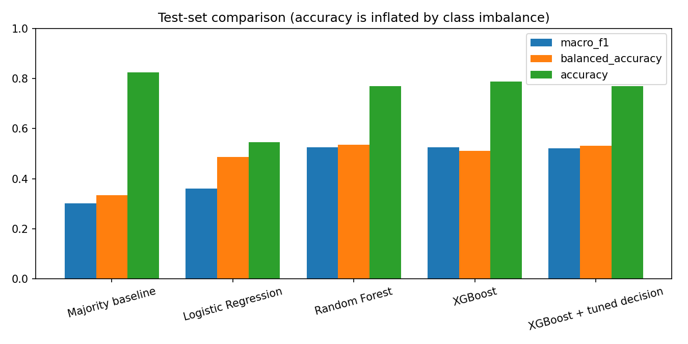
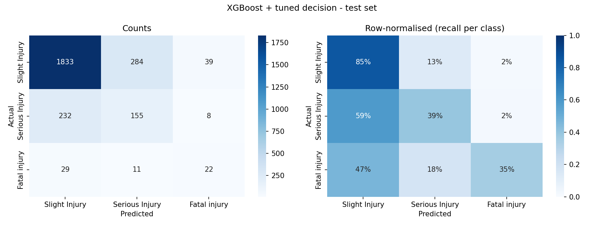
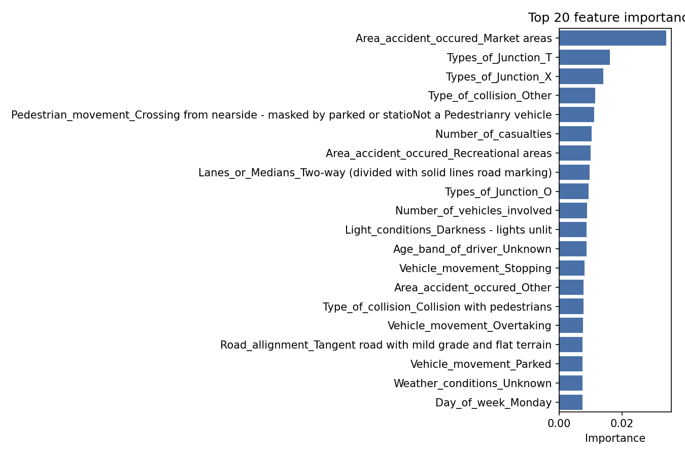

# Road Accident Severity Prediction: Addis Ababa

[](https://github.com/Donotyou/traffic-accident-severity/actions)


An end-to-end machine-learning project that predicts the **severity of a road accident**
(`Slight Injury`, `Serious Injury`, `Fatal injury`) from the circumstances in which it happened,
and serves the model through an interactive web app.

**Live demo:** <paste your Streamlit link here>

**Data → Model → Evaluation → Deployment**

| Stage | What happens | Where |
|---|---|---|
| **Data** | Load, validate, de-duplicate, stratified train/test split, EDA | `src/data.py`, notebook sections 2-4 |
| **Features** | Time as cyclical encoding, missing values as their own category, one-hot encoding (all inside one scikit-learn pipeline) | `src/features.py` |
| **Model** | Logistic Regression, Random Forest, XGBoost tuned with cross-validation, plus an ANN (MLP) in the notebook | `src/train.py`, notebook sections 8-10 |
| **Evaluation** | Macro-F1, balanced accuracy, MCC, per-class precision and recall, majority-class baseline | `src/evaluate.py`, `reports/` |
| **Deployment** | Streamlit app, GitHub Actions CI | `app/`, `.github/` |

---

## Key results

Held-out test set: 2,613 accidents (20 % stratified split), deployed model = **XGBoost with a tuned decision rule**.

| | Majority baseline | Deployed model |
|---|---|---|
| **Macro-F1** | 0.301 | **0.522** |
| **Balanced accuracy** | 0.333 | **0.532** |
| Accuracy | 0.825 | 0.769 |

The model is far better than the baseline at telling the three classes apart. Its accuracy is
lower than the baseline's on purpose: the baseline predicts `Slight Injury` for everything and
therefore never detects a serious or fatal accident.

<!-- Add two screenshots of the app to reports/figures/ and uncomment:


-->

## Dataset

Addis Ababa city road traffic accident records: **13,063 rows, 31 columns**, no duplicate rows.
Target is `Accident_severity`:

| Class | Count | Share |
|---|---|---|
| Slight Injury | 10,776 | 82.5 % |
| Serious Injury | 1,976 | 15.1 % |
| Fatal injury | 311 | 2.4 % |

Source: Enyew, G. G. (2025), *Addis Ababa City Road Traffic Accident Severity Dataset*, figshare,
<https://figshare.com/articles/dataset/Addis_Ababa_City_Road_Traffic_Accident_Severity_Dataset/28122899>.
Check the license on that page before redistributing the CSV.

Data quirk: one category label of `Pedestrian_movement` is malformed in the source file (it contains
the text "Not a Pedestrian" in the middle of a word). It is kept as is, because the one-hot encoding
treats it as an ordinary category and the model is not affected.

## Project structure

```
├── app/streamlit_app.py        # web app
├── .streamlit/config.toml      # app theme
├── src/
│   ├── config.py               # paths, constants
│   ├── data.py                 # loading, validation, split
│   ├── features.py             # preprocessing ColumnTransformer
│   ├── train.py                # tuning, comparison, selection, export
│   ├── evaluate.py             # metrics and plots
│   ├── postprocess.py          # decision-weight tuning for imbalanced classes
│   ├── report.py               # regenerate figures from the saved model
│   └── predict.py              # inference helper used by the app
├── notebooks/Traffic_Accidents_final_project.ipynb   # EDA + experiments (self-contained)
├── tests/                      # pytest (synthetic data, the real CSV is not needed)
├── data/                       # put Addis_Ababa_city_RTA.csv here
├── models/                     # model.joblib + metadata.json (generated by training)
├── reports/                    # metrics.json + figures (generated by training)
└── requirements*.txt, .github/workflows/ci.yml
```

## Quickstart

```bash
git clone https://github.com/Donotyou/traffic-accident-severity.git
cd traffic-accident-severity
python -m venv .venv && source .venv/bin/activate     # Windows: .venv\Scripts\activate
pip install -r requirements-dev.txt

# 1. Data: copy Addis_Ababa_city_RTA.csv into data/
# 2. Train and evaluate (writes models/ and reports/)
python -m src.train                # add --fast for a quick smoke run, --n-iter 10 for a shorter search
#    (re-create the report figures from the saved model without retraining: python -m src.report)
# 3. Run the app
streamlit run app/streamlit_app.py
# 4. Tests
python -m pytest -q
```

**Notebook:** put the CSV in the same folder as `notebooks/Traffic_Accidents_final_project.ipynb`
(or in `data/`), select the `.venv` kernel and run all cells. Do not run the notebook's export cell
after `python -m src.train`, because it overwrites `models/model.joblib`.

## Methodology

* **No data leakage.** Imputation, scaling and encoding are fitted on training folds only because
  they are steps of the `Pipeline`.
* **Imbalanced target.** Handled with class and sample weights, **not** with duplicate-oversampling
  before cross-validation: copies of the same row would sit in both the training and validation
  folds, inflating CV scores and favouring models that memorise. The notebook (section 6)
  demonstrates the effect.
* **Honest metrics.** A model that always predicts `Slight Injury` is already 82.5 % accurate, so
  we report **macro-F1**, **balanced accuracy**, **MCC** and **per-class precision and recall**,
  and compare everything to that majority baseline.
* **Model selection by cross-validated macro-F1 on the training set.** The test set is used once at
  the end and never for choosing models or hyper-parameters.
* **Decision-rule tuning.** Class probabilities are turned into predictions with per-class weights
  learned on out-of-fold training predictions (`src/postprocess.py`). They are kept only if they
  improve out-of-fold macro-F1 by a meaningful margin, and they are stored in
  `models/metadata.json` so the app uses them. In the final run the effect on the test set was
  small, so treat it as a precision/recall trade-off, not as a clear gain.
* **Missing values are information.** For example, a missing `Defect_of_vehicle` (35 % of rows)
  is its own category instead of being filled with the mode.

## Results

### Model comparison

Models are ranked by cross-validated macro-F1 on the training set.

| Model | CV macro-F1 | Test macro-F1 | Balanced acc. | Accuracy | MCC |
|---|---|---|---|---|---|
| Majority baseline | n/a | 0.301 | 0.333 | 0.825 | 0.000 |
| Logistic Regression | 0.368 | 0.361 | 0.487 | 0.546 | 0.117 |
| Random Forest | 0.523 | 0.526 | 0.536 | 0.771 | 0.247 |
| XGBoost | 0.541 | 0.526 | 0.511 | 0.788 | 0.267 |
| XGBoost + tuned decision (deployed) | 0.551* | 0.522 | 0.532 | 0.769 | 0.261 |

\* Out-of-fold macro-F1 of the weighted decision rule on the training set. The weights were tuned
on these same predictions, so this number is slightly optimistic.



* Macro-F1 improves from **0.30 (baseline) to about 0.52**, a real and cross-validated gain.
* Random Forest, XGBoost and the tuned decision rule are statistically indistinguishable on the test
  set; the differences are within noise, especially because only 62 test accidents are fatal.
* Logistic Regression is clearly weaker, which suggests that interactions between features matter.

### Deployed model: per-class performance

| Class | Precision | Recall | F1 | Test cases |
|---|---|---|---|---|
| Slight Injury | 0.88 | 0.85 | 0.86 | 2,156 |
| Serious Injury | 0.34 | 0.39 | 0.37 | 395 |
| Fatal injury | 0.32 | 0.35 | 0.34 | 62 |



Reading the confusion matrix:

* Of the 62 fatal accidents in the test set, the model identifies **22 (35 %)**; 29 of them (47 %)
  are predicted as slight injuries. It flags 69 accidents as fatal, of which 22 are correct.
* About 39 % of serious accidents are recognised, and most of the rest are predicted as slight.
* Slight injuries are recognised well (85 % recall).

In short: the model gives a useful risk signal, but it **misses many serious and fatal accidents**,
so it must not be used as the only basis for any decision.

### Feature importance



Importance is spread over many one-hot features rather than concentrated in a few, which is
consistent with the modest performance. The accident area (for example market areas), junction
type, collision type, pedestrian involvement and the number of casualties and vehicles are among the
most informative inputs. These are model importances, not causal effects.

## Deployment

**Streamlit Community Cloud (free)**
1. Train locally, then commit `models/model.joblib` and `models/metadata.json`.
2. Pin the scikit-learn version printed in `models/metadata.json` (`versions`) in `requirements.txt`.
3. Push to GitHub, open <https://share.streamlit.io>, choose *New app*, pick the repository and
   the main file `app/streamlit_app.py`.

**Secrets:** never commit tokens or keys. Use environment variables or the platform's secrets manager.

## Reproducibility

* Fixed seed (`random_state=42`) for the split, cross-validation and models.
* The fitted pipeline records the scikit-learn version it was trained with; the app warns on mismatch.
* Tests and CI run on synthetic data with the same schema, so they work without the real CSV.

## Limitations

* Many features describe the accident after it happened (casualty details), so this is a
  risk-assessment demo, not a tool for real-time prediction or decision making.
* The `Fatal injury` class has few examples (311 in total, 62 in the test set), so its estimates are noisy.
* Predictive signal in the available features is limited, which caps achievable performance.
* Data comes from a single city and period; performance may not transfer elsewhere.

## Possible next steps

Cost-sensitive evaluation (a missed fatal case costs more than a false alarm) · SHAP explanations ·
time-based split · geospatial features · probability calibration · model monitoring.
